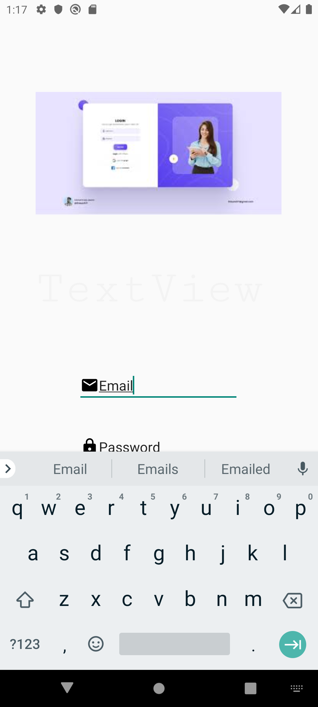
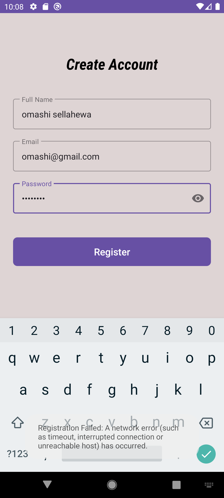
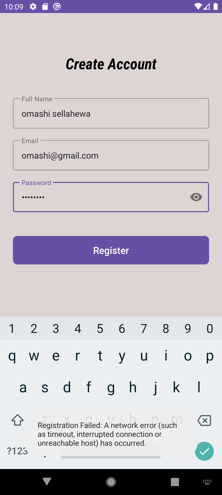
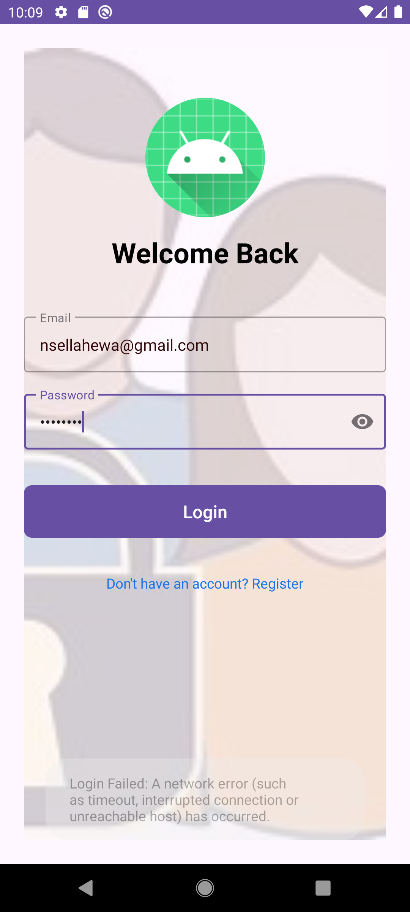
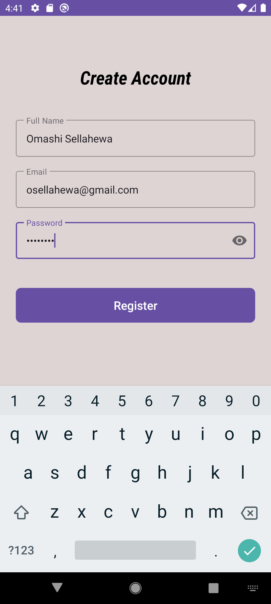
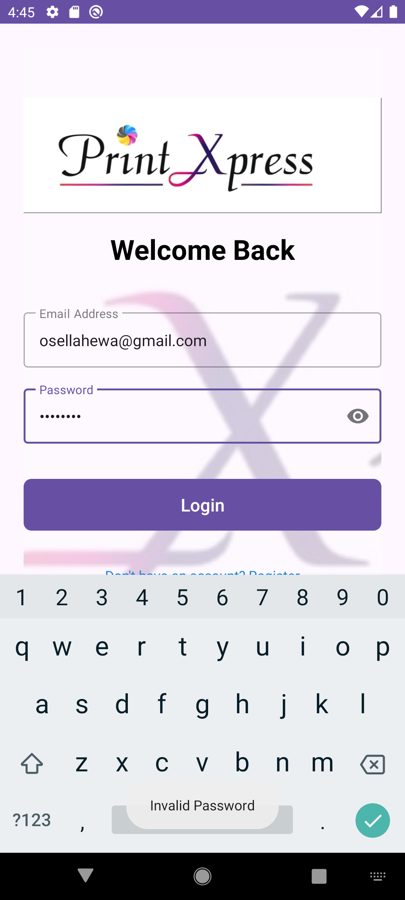
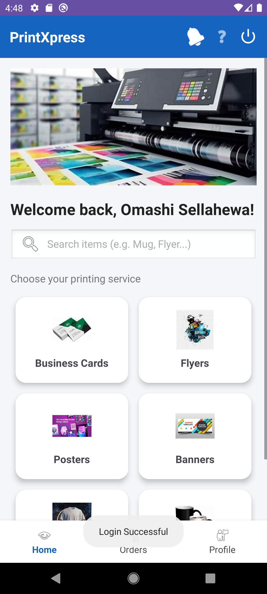

# KMC Event Management System

A full-stack Event Management System developed using **C#**, **ASP.NET Core Web API**, and an **ASP.NET Core MVC client**. The solution separates backend functionality, the frontend application, and the test project.

## Project Overview

This project demonstrates a structured web application with separate components for API operations, the web client, and software testing.

## Technologies Used

- C#
- ASP.NET Core Web API
- ASP.NET Core MVC
- .NET
- Swagger / OpenAPI
- Visual Studio
- Visual Studio Code
- Git and GitHub

## Project Structure

```text
KMC-Event-Management/
├── KMCEventAPI/          # Backend API project
├── KMCEventClient/       # Frontend MVC project
├── KMCEventAPI.Tests/    # Test project
├── KMCEventAPI.slnx      # Solution file
├── screenshots/          # Project screenshots
├── .gitignore
└── README.md
```

## Application Architecture

- **Backend API:** Handles API requests and server-side logic.
- **Frontend MVC Client:** Provides the web-based user interface.
- **Test Project:** Contains tests for the backend application.

## Project Screenshots

The following images are provided as project references. Their specific screens should be identified from the images.
















## Getting Started

### Prerequisites

- A compatible .NET SDK
- Visual Studio or Visual Studio Code
- Git

### 1. Clone the Repository

```bash
git clone https://github.com/omashi0816/KMC-Event-Management.git
cd KMC-Event-Management
```

### 2. Restore Dependencies

```bash
dotnet restore KMCEventAPI.slnx
```

### 3. Configure the Application

Configure any required local settings and database connections according to the project configuration.

**Security:** Do not commit passwords, API keys, or credentials to the repository.

### 4. Run the Backend API

```bash
dotnet run --project KMCEventAPI/KMCEventAPI.csproj
```

During local development, the Swagger interface has been accessed at:

`https://localhost:7285/swagger`

The actual URL may vary according to the launch settings.

### 5. Run the Frontend Client

Open the solution in Visual Studio, select the MVC client project, verify its required configuration, and run it using the appropriate launch profile.

### 6. Run Tests

Use Visual Studio Test Explorer to discover and run the available tests.

## Repository

[View KMC Event Management on GitHub](https://github.com/omashi0816/KMC-Event-Management)

## Developer

**Omashi Sellahewa**

Software Engineering | C# | ASP.NET Core | Web Application Development
